# Sheikha Unified Integration - Mermaid Architecture Diagram

```mermaid
graph TB
    subgraph TIER0["🏛️ TIER-0: SHEIKHA META-ORCHESTRATOR (Cloudflare Workers v35.1)"]
        CP["Control Plane<br/>NDA Shield + Auto-Responder"]
        AR["Request Router<br/>Arbitrage Engine"]
        RM["Revenue Meter<br/>D1 + KV"]
    end

    subgraph RING0["RING-0: NATIVE + BARE-METAL CORE"]
        NOS["Sheikha Native v11<br/>Bare-Metal OS Kernel<br/>140.92 MB LoRA<br/>Ed25519 Signed"]
        BMA["Bare-Metal Appliances<br/>Factory Deployment<br/>Air-Gapped<br/>&lt;1ms Latency"]
        HWIO["Hardware I/O<br/>Sensors/Actuators<br/>Real-Time Control"]
    end

    subgraph RING1["RING-1: EDGE + CDN + GATEWAY"]
        EDGE["Sheikha Edge<br/>Cloudflare Anycast<br/>1-2ms Global<br/>200+ PoPs"]
        CDN["Sheikha CDN<br/>Static Caching<br/>API Response Cache<br/>Geography-Aware"]
        GATEWAY["Cloud Gateway<br/>Unified API<br/>Auth + Validation<br/>OAuth 2.0 / SAML"]
    end

    subgraph RING2["RING-2: MULTI-CLOUD ARBITRAGE"]
        ARBIT["Smart Arbitrage Engine<br/>Latency + Cost Optimizer"]
        CNTXT["CNTXT / Google Cloud<br/>me-central2<br/>Primary Path"]
        AZURE["Microsoft Azure<br/>Saudi Central<br/>Secondary Path"]
        OPENAI["OpenAI API<br/>GPT-4 / Embeddings<br/>LLM Services"]
        AWS["AWS Lambda<br/>Spot Pricing<br/>Compute"]
        ALI["Alibaba Cloud<br/>stc Regional<br/>Backup"]
        NATL["National Clouds<br/>SDAIA / Aramco<br/>Sovereign"]
    end

    subgraph RING3["RING-3: COMMERCIAL ISV SERVICES"]
        ISV["ISV Revenue Engine<br/>Black-Box APIs<br/>No Code Exposure"]
        XRF["XRF Spectroscopy<br/>Purity Analysis<br/>10 SAR/req"]
        MILL["Millberry Grading<br/>Quality Assessment<br/>5 SAR/batch"]
        ZATCA["ZATCA Invoice Gen<br/>Phase-2 Certified<br/>3 SAR/invoice"]
        MARKET["Co-Branded Marketplace<br/>CNTXT + Google + Azure<br/>Revenue Share: 70/30"]
    end

    subgraph STORAGE["💾 STORAGE & DATA LAYER"]
        D1["D1 Database<br/>Deal Registry<br/>Revenue Tracking<br/>Audit Trail"]
        R2["R2 Storage<br/>Binary Uploads<br/>Backups<br/>Versioned"]
        KV["KV Cache<br/>API Responses<br/>Sessions<br/>Rate Limiting"]
        DO["Durable Objects<br/>WebSocket State<br/>Long Connections<br/>Notifications"]
    end

    subgraph AUTH["🔐 SECURITY & AUTH"]
        NDA["NDA Shield<br/>Supervisor-Key<br/>3-Level Access"]
        CRYPT["Encryption<br/>AES-256-GCM<br/>Ed25519 Signatures<br/>TLS 1.3"]
        OAUTH["OAuth 2.0<br/>Microsoft Entra ID<br/>API Keys<br/>SAML"]
    end

    subgraph REVENUE["💰 REVENUE MODEL"]
        GROSS["Gross Revenue<br/>100% Collected<br/>SAR / Crypto"]
        NET["Net Revenue<br/>After Cloud Costs<br/>62% Savings"]
        DIST["Distribution<br/>70% Reinvest<br/>20% Reserve<br/>10% Waqf"]
        TRACK["Milestone Tracking<br/>100 MT ✅<br/>500K SAR Q4<br/>2M+ SAR 2027"]
    end

    %% DATA FLOW
    CLIENT["👥 Clients<br/>Browser/Mobile<br/>IoT/Bare-Metal"]
    
    %% CONNECTIONS
    CLIENT -->|Request| EDGE
    EDGE -->|Validate| NDA
    EDGE -->|Cache Check| CDN
    CDN -->|Miss| GATEWAY
    GATEWAY -->|Route| AR
    AR -->|Decide| TIER0
    
    TIER0 -->|Local?| NOS
    NOS -->|Boot| BMA
    BMA -->|Hardware| HWIO
    
    TIER0 -->|Cloud?| ARBIT
    ARBIT -->|Select| CNTXT
    ARBIT -->|Select| AZURE
    ARBIT -->|Select| OPENAI
    ARBIT -->|Select| AWS
    ARBIT -->|Select| ALI
    ARBIT -->|Select| NATL
    
    TIER0 -->|ISV API?| ISV
    ISV -->|XRF| XRF
    ISV -->|Millberry| MILL
    ISV -->|ZATCA| ZATCA
    ISV -->|Marketplace| MARKET
    
    TIER0 -->|Store| D1
    TIER0 -->|Cache| KV
    TIER0 -->|Logs| R2
    TIER0 -->|State| DO
    
    TIER0 -->|Security| NDA
    TIER0 -->|Security| CRYPT
    TIER0 -->|Security| OAUTH
    
    RM -->|Track| GROSS
    RM -->|Calculate| NET
    RM -->|Distribute| DIST
    RM -->|Monitor| TRACK
    
    CNTXT -->|Response| EDGE
    AZURE -->|Response| EDGE
    OPENAI -->|Response| EDGE
    AWS -->|Response| EDGE
    ALI -->|Response| EDGE
    NATL -->|Response| EDGE
    
    HWIO -->|Response| EDGE
    ISV -->|Response| EDGE
    
    EDGE -->|Return| CLIENT
    
    style TIER0 fill:#ff6b6b,stroke:#333,color:#fff
    style RING0 fill:#4ecdc4,stroke:#333,color:#fff
    style RING1 fill:#45b7d1,stroke:#333,color:#fff
    style RING2 fill:#96ceb4,stroke:#333,color:#fff
    style RING3 fill:#ffeaa7,stroke:#333,color:#333
    style STORAGE fill:#a29bfe,stroke:#333,color:#fff
    style AUTH fill:#fd79a8,stroke:#333,color:#fff
    style REVENUE fill:#74b9ff,stroke:#333,color:#fff
```



## Data Flow Summary

```
REQUEST JOURNEY:
1. Client hits Sheikha Edge (Cloudflare) — 1-2ms latency
2. NDA Shield validates supervisor-key (if needed)
3. CDN checks for cached response
4. Gateway validates request + authenticates
5. Control Plane routes to:
   - Bare-Metal (if offline/local) → <1ms
   - Multi-Cloud (if compute) → 25-60ms (but optimized)
   - ISV API (if business logic) → 5-20ms
6. Response encrypted + returned to client
7. Transaction logged in D1
8. Revenue tracked + profit distributed

TYPICAL LATENCY:
├─ Edge: 1-2 ms (Cloudflare Anycast)
├─ Gateway: 1 ms (validation)
├─ Bare-Metal: 0 ms (direct hardware)
├─ Cloud: 20-50 ms (network + processing)
└─ Total: 1-2ms (best) to 20-50ms (average)

COST ADVANTAGE:
└─ 62% cheaper via multi-cloud arbitrage + 4-bit NF4 LoRA
```

## Integration Points

```
Sheikha Native V11
├─ Runs on: Bare-Metal appliances (factory floor)
├─ Deployment: Air-gapped, no internet
├─ Boot: Ed25519-signed boot.img (QEMU-tested)
└─ Purpose: Real-time sensor processing, no cloud dependency

Sheikha Bare-Metal
├─ Hardware: Industrial-grade appliances
├─ Connection: Optional Sheikha Edge gateway
├─ Fallback: 100% offline operation
└─ Purpose: Factories, mining, supply-chain

Sheikha Cloud
├─ Orchestrator: Arbitrage across 6 clouds
├─ Selection: Latency + cost per-request
├─ Encryption: Client-side before cloud sees data
└─ Purpose: Compute, storage, ML services

Sheikha CDN
├─ Layer: Cloudflare global network
├─ Cache: Static assets + API responses
├─ Geography: Aware of client location
└─ Purpose: Fast content delivery worldwide

Sheikha Edge
├─ PoPs: 200+ locations (6 SA regions)
├─ Latency: 1-2ms guaranteed
├─ Security: DDoS + rate limiting
└─ Purpose: First-request entry point

UNIFIED CONTROL:
Sheikha Control Plane (Workers) → Decides which ring to use
├─ Ring 0 (Bare-Metal)? → Send to NOS V11
├─ Ring 1 (Edge/CDN)? → Cache + return
├─ Ring 2 (Cloud)? → Arbitrage routing
└─ Ring 3 (ISV)? → Black-box API call
```

## Deployment Checklist

```
✅ TIER-0 (Control Plane)
   ├─ Cloudflare Workers v35.1 deployed
   ├─ Durable Objects active
   ├─ NDA Shield enforced
   └─ Auto-responder running 24/7

✅ RING-0 (Native + Bare-Metal)
   ├─ Sheikha Native V11 built + tested
   ├─ Boot image signed + verified
   ├─ LoRA weights sealed (140.92 MB)
   └─ Bare-metal appliance docs ready

✅ RING-1 (Edge + CDN)
   ├─ 16 Cloudflare Workers bound
   ├─ KV cache operational
   ├─ R2 storage connected
   └─ Geography routing live

✅ RING-2 (Multi-Cloud)
   ├─ CNTXT/Google Cloud ready
   ├─ Azure OAuth ready
   ├─ OpenAI routing ready
   ⏳ AWS integration (Week 1)
   ⏳ Alibaba integration (Week 2)
   ⏳ National Cloud integration (Week 3-4)

✅ RING-3 (ISV Services)
   ⏳ XRF API beta (Week 2)
   ⏳ Millberry Grading (Week 3)
   ⏳ ZATCA Invoicing (Week 4)
   ⏳ Marketplace launch (Week 5)

✅ Storage & Data Layer
   ├─ D1 database operational
   ├─ R2 bucket connected
   ├─ KV namespace active
   └─ Durable Objects stateful

✅ Security & Auth
   ├─ NDA Shield 3-level access
   ├─ AES-256-GCM encryption
   ├─ Ed25519 signatures
   └─ OAuth 2.0 ready
```

