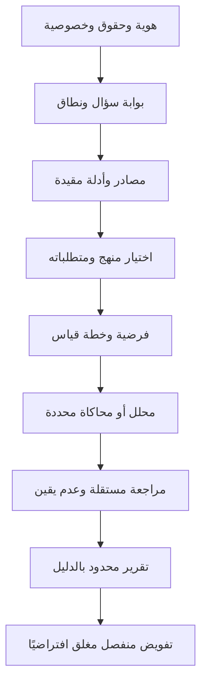

# شيخة — معمارية البحث والمنهجيات والذكاء

هذه مواصفة تنفيذ أولي فوق 29 طبقة تأسيس سابقة. الجذور: الهوية والمقصد والحقوق وحفظ البيانات. الأركان: المصدر، السؤال، المنهج، القياس، التجربة، المراجعة، وحدود النتيجة. مرجعية القيم الكتاب والسنة مع مراجعة مؤهلة، ولا فتوى آلية أو تصريح امتثال شامل.

## الأدوات وحالة التنفيذ

| الأداة | الملف | التنفيذ المثبت |
|---|---|---|
| لغة المواصفات | sheikha-language/foundations/sheikha-methodologies-v1.shk | ترجمة وVM محلي |
| كتالوج المناهج | core/research/sheikha-methodology-catalog-v1.json | 11 ملف منهج ومتطلبات محددة |
| منسق البحث | core/research/sheikha-research-brain-v1.cjs | اختيار وخطة ومتطلبات دون استنتاج نهائي |
| محلل وصفي | summarize في النواة البحثية | عدد ومتوسط وحد أدنى وأعلى لعينة محدودة |
| قارئ الأدلة | مشروع sheikha_os_ecosystem / evidence_registry_v2 | قراءات محددة no-follow وبصمات محتوى |
| المختبر الروبوتي | core/robotics | محاكاة حالات وخلايا، لا فيزياء معايرة |
| النواة الأصلية | bare-metal/runtime | برنامج أصلي محدود وVM تجريبي |

المناهج الأولية: وصفي، تجريبي، إحصائي، استقرائي، استنباطي، مقارن، تاريخي، نوعي، مختلط، محاكاة، مراجعة منهجية. لكل منها متطلبات مختلفة في الكتالوج. لا توجد قائمة محدودة تمثل جميع منهجيات العلوم؛ إضافة تخصصات تتم بملفات منهج وإصدارات واختبارات، ولا يجوز تفعيلها جماعيًا من اسمها.

## المواصفات والقواعد واللوائح المقترحة

حد سؤال2000حرف، 32مرجعًا بمعرف محدود، عينات عددية محدودة10000قيمة؛ رفض حقول إضافية وقيم غير منتهية. لا تُعتبر معرفات الأدلة روابط مؤكدة: المنسق لا يتحقق من المحتوى وحده، sourceValidity=UNKNOWN. لا علاقة سببية أو تعميم مجتمع من متوسط عينة. لا تغيير برمجيات ذاتي أو تفويض حركة أو دفع من خطة البحث.

لائحة بحث داخلية مقترحة: تصريح الوصول ومصدر وتاريخ البيانات، خطة وتحليل مسبقان عند ملاءمتهما، سجل فرضيات وفشل، الفصل بين بيانات اختبار وبيانات واقعية، حفظ إصدارات، مراجعة مستقلة وتقرير حدود. لائحة إصدار مقترحة: فحوص قبل القبول، صلاحية محددة، تراجع، رصد، لا ترقية تلقائية. لوائح الجهات الرسمية وأحكام العقود والسلامة والبحث البشري تُراجع وفق المجال والدولة؛ هذه الوثيقة ليست قانونًا نافذًا أو اعتمادًا نظاميًا.

## برامج الذكاء المستهدفة

AGI: قدرة تعميم وتعلم تُقاس بصورة مستقلة، غير مثبتة. ASI: هدف بحثي بعيد غير مثبت. الجسدي: إدراك وتحكم بعد تأهيل العتاد، UNKNOWN. الهجين والمعزز: تعاون الإنسان مع أداة قابلة للمراجعة. التطور الذاتي: تجارب تحسين معزولة لا تغير الإنتاج دون تفويض. الاجتماعي والعاطفي: فهم سياق وتواصل محترم، لا ادعاء إحساس داخلي. جميع شهادات تحقيق هذه القدرات UNKNOWN؛ وجود الكتالوج ليس إثباتها.

## التنظيم وبوابات الاعتماد

باحث يحدد السؤال، مسؤول بيانات يراجع المصدر والحقوق، مهندس يبني الأداة، مراجع منهجي مستقل يقيّم التصميم والنتائج، مراجع تخصصي للقرارات المؤثرة، ومعتمد إصدار منفصل. الأشخاص المعينون UNKNOWN. بوابات العمل: مواصفة → تنفيذ محدود → اختبار نجاح وفشل → بيانات مأذونة → مراجعة مستقلة → اعتماد نطاق محدد. لا بوابة تمنح تشغيل عتاد أو نشرًا تلقائيًا.

الخطوة التالية بناء محلل واحد لمنهج ودراسة محددين وربطه بأدلة حقيقية. المقاييس: صحة استنتاج على مهام جديدة، خطأ وعدد فشل، تفسير وحدود، زمن وتكلفة، خصوصية ومنفعة مقاسة. الأهداف العددية UNKNOWN إلى أن يحدد خط أساس، ولا تُخترع درجات تفوق عالمي.
