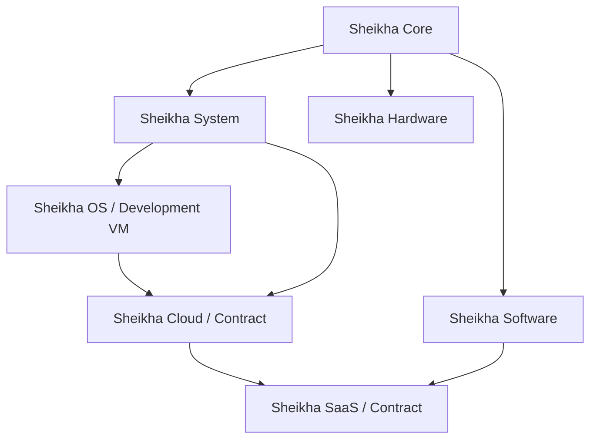

# Sheikha — Core / System / OS / Cloud / SaaS / Software / Hardware

تأسيس محلي موحّد بلغة شيخة. المصدر sheikha-language/foundations/sheikha-system-stack-v1.shk. الفحص يترجم سبعة كيانات محددة ثم ينفذ علامة التأسيس في VM محكوم، ويجمع الأدلة المحلية من مكونات النظام. لا يعني إنتاج كيانات تشغيل خدمات أو تجهيز سحابة.

| المكوّن | مسؤولية التأسيس | الدليل الحالي | النقص |
|---|---|---|---|
| Core | العقود والقبول والحوكمة | تركيب عقود محلي | خدمة إنتاجية UNKNOWN |
| System | سجل وترابط الوحدات | سبعة كيانات مترجمة وVM محلي | مدير خدمات شامل UNKNOWN |
| OS | نظام تشغيل وتجهيز تشغيل أصلي | سلامة الملفات مع دليل إقلاع VM سابق | شبكة وتخزين دائم وعزل وتحميل ديناميكي وترحيل الخدمات غير مكتملة |
| Cloud | تنسيق موارد وحزم سحابية | عقد تصميم محلي | تجهيز موارد وتوافر واستعادة ومراقبة UNKNOWN |
| SaaS | خدمة متعددة المستأجرين | عقد تصميم محلي | عزل مستأجرين وتشغيل واستعادة واختبارات خدمة UNKNOWN |
| Software | اللغة والمترجم والبرمجيات | فحص مترجم وVM فعلي | ترحيل كل خدمات المنصة UNKNOWN |
| Hardware | سياسات قبول العتاد وFirmware | فحص منع الكتابة | عتاد موصول ومعايرة واعتماد تشغيل UNKNOWN |

الدليل runtime/sheikha-system-stack/v1/verification.json. الفحص الحالي لا يعيد إقلاع VM ولا يبدأ daemon ولا ينشر أو يجهز سحابة أو يعيد تشغيل VPS أو يكتب Firmware. لا معلومات مالك أو أسرار ضمن السجل. التفعيل الإنتاجي والفيزيائي لكل مكوّن UNKNOWN وproductionReady=false.

التشغيل: node tools/production/sheikha-system-stack-v1.cjs للقراءة؛ --write لحفظ تقرير محلي. تُرفض خيارات live وapproval وrestart. المضيف الحالي Node.js؛ الاستقلال الأصلي يخص نموذج OS التجريبي المذكور في SHEIKHA-INDEPENDENT-DEPLOYMENT-ENVIRONMENT-V1.md فقط.

الخطوات التنفيذية التالية تُحدد حول هدف نشر ومضيف وموارد وخدمات معروفة: استكمال طبقات OS؛ إنشاء خطة Cloud بأدلة ومقاييس تشغيل؛ تنفيذ عزل SaaS واختباراته؛ ربط Hardware محدد ومعاير. أي نشر أو تشغيل عتاد يحتاج نطاقًا وموافقة مستقلة. القيم الشرعية تتطلب مراجعة مؤهلة ولا تمثل اعتمادًا آليًا.
