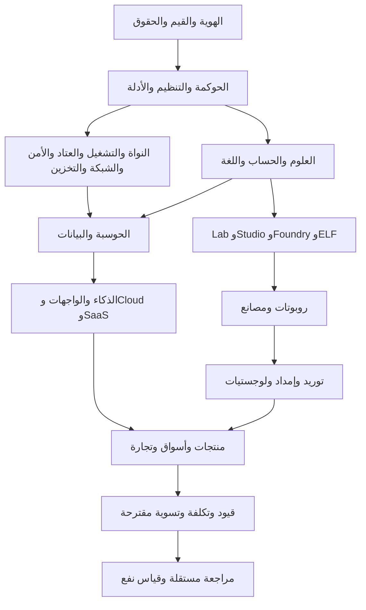

# شيخة — الهيكل والأسس والمعمارية الموحدة بلغة شيخة

منظومة متعددة التخصصات للصناعة والتجارة والمعرفة والحوسبة. طموح أن تصبح مرجعًا أساسيًا للعلوم والتقنية هدف مستقبلي؛ لا تُعد هذه الوثيقة إثباتًا لاكتشاف علم مستقل أو تفوق عالمي.

المصدر sheikha-language/foundations/sheikha-unified-foundations-v1.shk. ترجم إلى IR وBytecode ثم نُفذ في VM محكوم. 29 عقدًا محددًا بدور ومدخل ومخرج وتبعية ومعيار قبول، وحالة DESIGN_CONTRACT وتشغيل حقيقي UNKNOWN. نتائج البناء runtime/sheikha-unified-foundations/v1/contracts.json وbytecode.json. تشغيل البناء المحلي node tools/production/sheikha-unified-foundations-v1.cjs. التصريحات والخصائص المعمارية ليست محركات تنفيذ كاملة ولا ضوابط قانونية منفذة.

## الجذور والأركان

الهوية والمقصد والحقوق → حوكمة التفويض → مصادر وأدلة → منهج علمي → حساب ووحدات → لغة وبرمجيات. القيم المرجعية الكتاب والسنة، الأمانة والعدل والإتقان وحفظ الحقوق وبلا ضرر ولا ضرار؛ المراجعة الشرعية المتخصصة لأهل العلم، والاعتماد النظامي للمختصين. ملكية المنشأة لا تمنح ملكية العلوم أو المكتبات الخارجية أو معاملات الآخرين.

## البنية التحتية والفوقية

الفوندري يبني، والاستوديو يصمم، والمختبر يختبر، وسجل الأدلة يقيس حدود الدليل. مصنع ELF يربط ويفحص الملفات الأصلية ولا يتحول إلى محرك اقتصاد لمجرد التسمية. مكونات البنية يمكن تطويرها بصورة مستقلة؛ لا يوجب مخطط التبعيات إيقاف خدمات أو تعليق تطوير مسار حتى اكتمال المنظومة كلها.

## التنظيم واللوائح والخواص

لكل طبقة مسؤول مكوّن ومراجع تقني، وللتغييرات المؤثرة مراجع سلامة أو أمن أو محاسبة أو عقود بحسب النطاق، ومعتمد إصدار منفصل. تعيين الأشخاص UNKNOWN. تُسجل اللوائح بالمصدر الرسمي والبلد والقطاع والإصدار وتاريخ السريان والنطاق والمراجع؛ لا اعتماد لائحة مخترعة أو تعميم حكم دولة على العالم. الصفات المقترحة: محدودية التفويض، قابلية الفحص، فصل المسؤوليات، أقل صلاحية، حدود الموارد، حفظ المصدر والوحدات والحقوق، ورفض غياب الدليل.

## التجارة والأموال

عقد المنتج يصف المادة والمواصفة والوحدة والملكية والجهة والموقع؛ عقد العرض يصف القيمة والعملة والصلاحية وشروطه ومصدره. التصنيف الجمركي عند انطباقه يُراجع للسلعة والدولة. القيود المالية المقترحة تتضمن مستندًا ومبلغًا وعملة وحسابين أو أكثر، وتوازن مدين ودائن، وتصحيحات بإصدارات قابلة للتتبع بدل محو السجلات. هذا وصف نطاق لا نظام محاسبة عاملًا أو اعتمادًا ضريبيًا أو شرعيًا. الدفع والتحصيل والتعاقد والتداول والاستثمار الآلي غير مأذون بها. لا ربح مضمون ولا اقتطاع من تجارة الغير بلا استحقاق وعقد معتبر.

## مقاييس الأفضل والأنفع

| المجال | معيار مقترح | القياس الحالي |
|---|---|---|
| العلوم | فرضيات قابلة للاختبار ومراجعة وإعادة فحص | UNKNOWN |
| الحساب | دقة ووحدات وحدود خطأ | UNKNOWN للمواصفة العامة |
| البرمجيات | أخطاء وفشل واختبارات سلوك وأمان | أدلة مكوّنات محلية سابقة؛ لا تعميم |
| النواة | زمن استجابة وعزل واستعادة | إقلاع VM محدود؛ المقاييس الشاملة UNKNOWN |
| الروبوت | نجاح مهمة وأخطاء وقوة وطاقة وتوقف | محاكاة بسيطة؛ عتاد UNKNOWN |
| المصنع | جودة وهدر وإنتاجية وتتبع | حالات تجريبية؛ إنتاج فعلي UNKNOWN |
| الإمداد | دقة مخزون وزمن تسليم ومطابقة | UNKNOWN للعمليات الفعلية |
| التجارة | ربح وتكلفة ونقد ورضا بعقود موثقة | عروض الخردة والباريت معلقة |
| النفع | أثر مقاس بخط أساس وموافقة وحقوق | UNKNOWN |

البرنامج التالي: تحويل عقود التصميم إلى متطلبات اختبار وإصدارات محددة، اختيار نطاق أولي، بناء كل مكوّن وفحصه منفصلًا ثم اختبار تكامل واجهاته؛ لا إعلان تفعيل شامل من نجاح مترجم. الأولوية الحالية Evidence V2 Task2 المستقل، ثم لغة وواجهة وروبوت رقمي وبيانات فرص موثقة مع استمرار تطوير النواة والفوندريات. لا يعاد RERUN_ALLOWED=false.
