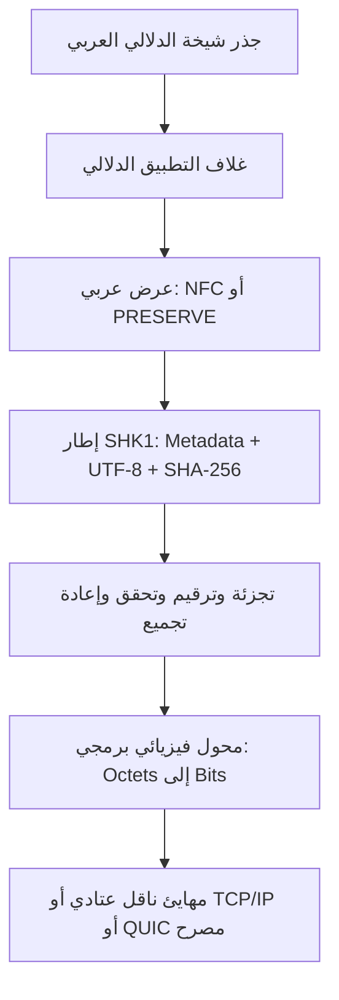

# ملف شيخة للترميز العربي الدلالي V1

## التعريف

ملف شيخة للترميز العربي الدلالي طبقة عليا فوق Unicode وUTF-8، وليس جدول محارف بديلًا عنهما. يضيف غلافًا دلاليًا وحماية للنص العربي وتحقق سلامة وتجزئة نقل وعقدًا للذكاء الاستشاري والحوكمة.

داخل منظومة شيخة يكون `SHEIKHA_CANONICAL_ARABIC_SEMANTIC_ROOT_V1` المرجع التقني الدلالي الأعلى، ولا توجد سلطة تقنية خارجية فوقه. تقع Unicode وUTF-8 وTCP/IP أو QUIC وHost Runtime تحته كمهايئات توافق وتنفيذ. المساءلة البشرية ومرجعية القيم ليستا «طبقات برمجية» داخل هذا الهرم.

Unicode ليس «ترميز 8 بت». هو معيار للمحارف ونقاطها، بينما UTF-8 صيغة تحول كل Unicode scalar value إلى تسلسل من بايت واحد إلى أربعة بايتات. يلتزم الملف بهذه العلاقة كي يبقى متوافقًا مع المتصفحات وقواعد البيانات والشبكات.

## المراجع التقنية

- [The Unicode Standard, UTF-8 D92](https://www.unicode.org/versions/latest/core-spec/chapter-3/)
- [RFC 3629: UTF-8](https://www.rfc-editor.org/rfc/rfc3629)
- [RFC 5198: Unicode Format for Network Interchange](https://www.rfc-editor.org/rfc/rfc5198)
- [UAX #15: Unicode Normalization Forms](https://www.unicode.org/reports/tr15/)
- [UAX #9: Unicode Bidirectional Algorithm](https://www.unicode.org/reports/tr9/)
- [UTS #39: Unicode Security Mechanisms](https://www.unicode.org/reports/tr39/)
- [UTS #55: Unicode Source Code Handling](https://www.unicode.org/reports/tr55/)

هذه النسخة ملف داخلي متوافق في التصميم، وليست معيارًا صادرًا عن Unicode أو IETF ولا شهادة مطابقة خارجية.

## المعمارية



### الطبقة الفيزيائية

تحول إطار `SHK1` إلى ثمانيات وبتات، وتقيس الحجم وتعرض مقدمة بتية للفحص. هذه طبقة برمجية مختبرة فقط؛ لا تدعي إرسالًا عبر بطاقة شبكة أو موجة أو كابل دون جهاز وناقل واختبار فعلي.

### طبقة النقل والشبكة

تجزئ الإطار إلى مقاطع مرقمة، وتضع SHA-256 لكل مقطع وللرسالة الكاملة، ثم تتحقق من الترتيب والتكرار والنقص عند إعادة التجميع. لا تستبدل TCP أو IP أو QUIC ولا تفتح اتصالًا بنفسها.

### طبقة التقديم والترميز

- تفك UTF-8 بفشل صريح عند التسلسل غير القانوني.
- تستخدم NFC للنص العام.
- تستخدم `PRESERVE` للنص الديني المنقول كي لا تغير وحدات النص الأصلية.
- لا تحذف التشكيل ولا تطوي `ة` إلى `ه` أو `ى` إلى `ي`.
- تكشف محارف الاتجاه الصريحة وتطلب مراجعة بدل تمريرها افتراضيًا.
- ترفض surrogate غير المكتمل وBOM داخل الحمولة.

### طبقة التطبيقات

تضيف نوع الرسالة والنية ومعرف الارتباط ومستوى المخاطر وحالة الموافقة البشرية. نتيجة الترميز لا تمنح صلاحية تنفيذ ولا إذن شبكة.

## بنية الإطار

الرأس الثابت 48 بايتًا:

| الحقل | الحجم |
|---|---:|
| Magic `SHK1` | 4 |
| Version | 1 |
| Flags | 1 |
| Header length | 2 |
| Metadata length | 4 |
| Payload length | 4 |
| SHA-256 | 32 |

يتبع الرأس JSON معياري مرتب المفاتيح ثم حمولة UTF-8. SHA-256 هنا لكشف العبث، وليس توقيعًا ولا مصادقة ولا تشفيرًا؛ يلزم TLS أو توقيع مستقل عند الحاجة.

تعرض API الإطار والمقاطع بصيغة Base64URL غير مبطنة، لتجنب محارف `+` و`/` و`=` داخل JSON والوسطاء الأمنيين. يبقى المحرك قادرًا على قراءة Base64 القياسي للتوافق.

## الذكاء الصناعي

عقد الذكاء `SHEIKHA_AI_ENCODING_ADVISORY_V1` مفعّل في طبقة التطبيق. ينشئ طلبًا استشاريًا مرتبطًا ببصمة الحمولة، لكنه لا يستدعي نموذجًا داخل مسار الترميز، ولا يغير البايتات، ولا يمنح صلاحية، ولا يصدر حكمًا شرعيًا. تشغيل نموذج خارجي قرار منفصل ومصرح يخضع للمراجعة البشرية.

يمكن للذكاء صياغة **مقترح تحسين**، لكن المقترح يبقى `PROPOSAL_REVIEW_REQUIRED`. لا يغير Runtime نفسه، ولا يفعّل إصدارًا جديدًا، حتى تمر أدلة الأمن والتوافق والرجوع المطابق وقياس الأداء والمراجعة البشرية والإصدار المرقم.

## الحوكمة

القيم المرجعية هي القرآن والسنة الصحيحة وفق [عقد المرجعية](/docs/universal-benefit-boundary-v1/SHEIKHA-ISLAMIC-VALUE-REFERENCE-CONTRACT-V1.md). المرجعية ليست bytecode ولا بديلًا للقياس الهندسي. لا يحدد البرنامج الحلال والحرام، وتلزم مراجعة عالم مؤهل عند التفسير الشرعي، ومراجعة سلامة المصدر عند نقل نص ديني.

يسجل الملف مراجع التثبت (`الحجرات: 6`)، وعدم اتباع ما لا علم به (`الإسراء: 36`)، والعدل والإحسان (`النحل: 90`)، وحديث «لا ضرر ولا ضرار» مع بيانات الراوي والمصدر والحكم المسجلة. تستخدم هذه مراجع قيم ومراجعة، بينما يثبت الترميز نفسه باختبار UTF-8 والرجوع المطابق والبصمات وقياس الحجم.

## معنى «أفضل» القابل للإثبات

التحسين المثبت في V1 هو حفظ العربية، والتحقق الصارم، وإظهار مخاطر الاتجاه، وكشف العبث، والغلاف الدلالي، وحدود الذكاء والحوكمة. الغلاف أكبر من UTF-8 الخام، ولا توجد دعوى أنه أسرع أو أصغر. أي ادعاء أداء لاحق يحتاج benchmark متكررًا على جهاز وحمولة محددين.

## واجهات API

- `GET /api/language/arabic-semantic-encoding/status`
- `GET /api/language/arabic-semantic-encoding/specification`
- `POST /api/language/arabic-semantic-encoding/analyze`
- `POST /api/language/arabic-semantic-encoding/explain`
- `POST /api/language/arabic-semantic-encoding/improvement-plan`
- `POST /api/language/arabic-semantic-encoding/encode`
- `POST /api/language/arabic-semantic-encoding/decode`
- `POST /api/language/arabic-semantic-encoding/segment`
- `POST /api/language/arabic-semantic-encoding/reassemble`

يقبل `/encode` التصنيف الدلالي في `contentClass`، كما يقبل `contentType` اسمًا بديلًا متوافقًا. القيمة `RELIGIOUS_SOURCE` تفرض `PRESERVE` حتى لا يغير التطبيع تسلسل النص المنقول. وإذا أُرسل الحقلان بقيمتين مختلفتين يُرفض الطلب بدل اختيار إحداهما بصمت. تُعاد الإطارات والمقاطع بصيغة Base64URL غير مبطنة داخل JSON.

## التشغيل

```bash
npm run -s ops:arabic-semantic-encoding:activate:v1
npm run -s ops:arabic-semantic-encoding:test:v1
```

تقرير التفعيل: `runtime/arabic-semantic-encoding/v1/sheikha-arabic-semantic-encoding-v1-report.json`.

## حد الاستقلال الحالي

الجذر الدلالي عربي وأعلى داخل معمارية شيخة، لكن التنفيذ الحالي مستضاف على Node ويستخدم Unicode/UTF-8 ومحولات الشبكة الموجودة. لم يكتمل بعد codec عتادي أصلي أو ناقل شبكة مستقل أو Runtime ذاتي الاستضافة؛ لذلك لا يدعي V1 إزالة المضيف أو ترميز كل البيانات الثنائية. هذه أعمال إصدارات لاحقة لا تصبح `VERIFIED` إلا بأثر إقلاع واختبار عتاد وقياسات توافق.
