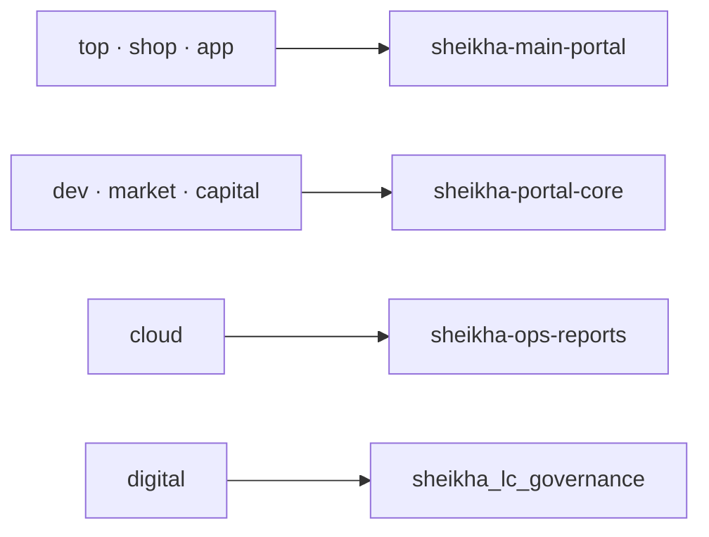

# شيخة — خريطة النطاقات والخدمات المستهدفة — الإصدار الأول

التاريخ: 2026-10-22. المصدر: خريطة المستخدم المعتمدة لهذه المهمة. الحالة: `TARGET_APPROVED / LIVE_NOT_VERIFIED`.

توثق هذه الخريطة الوجهة المطلوبة لكل اسم نطاق. اعتماد الهدف لا يثبت ملكية النطاق أو إعداد DNS أو شهادة TLS أو وجود الخدمة أو نجاح نشرها؛ لم تُجرَ استعلامات حية لإثباتها ضمن هذه الوثيقة. تتبع الخريطة [سجل المصدر الرسمي](../registry/ROOT-SOURCE-OF-TRUTH.md) و[حوكمة المساعدين](../canonical/environment/SHEIKHA-ASSISTANT-GOVERNANCE.md).

## التعيين المعتمد

| النطاق | نوع التوجيه المطلوب | الخدمة أو الوجهة المستهدفة |
| --- | --- | --- |
| `sheikha.top` | خدمة | `sheikha-main-portal` |
| `sheikha.dev` | خدمة | `sheikha-portal-core` |
| `sheikha.cloud` | خدمة | `sheikha-ops-reports` |
| `sheikha.digital` | خدمة | `sheikha_lc_governance` |
| `sheikha.shop` | خدمة | `sheikha-main-portal` |
| `sheikha.market` | خدمة | `sheikha-portal-core` |
| `sheikha.capital` | خدمة | `sheikha-portal-core` |
| `sheikha.money` | إعادة توجيه HTTP `301` | `https://sheikha.capital` |
| `sheikha.app` | خدمة | `sheikha-main-portal` |
| `sheikha.me` | إعادة توجيه HTTP `301` | `https://sheikha.top/profile` |
| `sheikha.site` | إعادة توجيه HTTP `301` | `https://sheikha.top` |
| `sheikha.click` | إعادة توجيه HTTP `301` | `https://sheikha.shop` |

الخريطة تضم ثمانية نطاقات مرتبطة بأربع خدمات، وأربعة نطاقات تعيد التوجيه. أسماء الخدمات معرّفات مستهدفة كما حددها المستخدم؛ لا تُحوَّل تلقائيًا إلى موارد Cloud Run أو مضيفات أو مشاريع سحابية مفترضة. تبقى أسماء الخدمات والشرطات والشرطة السفلية كما وردت.

الأسماء المختصرة في الرسم كلها تحت `sheikha.`؛ وجهات `301` محددة كاملةً في الجدول.

## حدود التنفيذ والتحقق

هذه وثيقة معمارية فقط. تغيير DNS أو ربط نطاق أو إصدار شهادة أو تعديل middleware أو نشر خدمة عملية مستقلة تتطلب تفويضًا يغطي الخدمة والبيئة والفعل وفق مستوى `L1` في [حوكمة النواة](../governance/SHEIKHA-INFINITE-AGENT-KERNEL-V1.md). لا تضيف هذه الوثيقة صلاحيات، ولا تمس سجلات البريد `MX/SPF/DKIM/DMARC`.

قبل التطبيق يلزم جرد الحالة الفعلية وملكية النطاق وصلاحية الحساب، وتحديد موارد الخدمات وبيئاتها، وتوثيق الفرق وخطة الرجوع. يجب تنفيذ التوجيه الدائم في طبقة HTTP مناسبة؛ سجل DNS وحده لا يُنشئ استجابة `301` أو مسار `/profile`.

تثبت معايير القبول لكل نطاق على حدة: صحة الوجهة وTLS، وحالة HTTP، وبقاء اسم النطاق عند ربط الخدمة، ومطابقة `Location` للوجهة المعتمدة عند إعادة التوجيه، وعدم وجود حلقات تحويل. لا يفترض هذا الإصدار سياسة لتمرير مسارات أو معاملات طلبات أخرى، أو دعم `www` أو النطاقات الفرعية؛ تُوثق هذه التفاصيل في عقد التنفيذ قبل تغييرها.

يسجل دليل التحقق التاريخ والبيئة ومصدر الرصد والنتيجة لكل نطاق. إلى حين وجوده تبقى الخريطة `LIVE_NOT_VERIFIED`، حتى لو نجح بناء صورة إحدى الخدمات.
