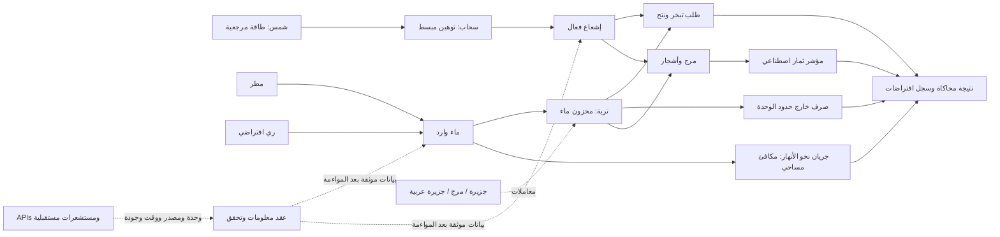

# هندسة التكامل الطبيعي في شيخة — V1

**التاريخ:** 2026-10-22. **النطاق:** مواصفة نموذج تعليمي اصطناعي ليوم واحد، مع عقد مستقبلي لتبادل بيانات الرصد. التنفيذ في `runtime/sheikha-natural-integration/v1/`؛ لا تُثبت السيناريوهات اتصالاً بمستشعرات أو شراكة دولية أو تشغيلاً ميدانياً.

## المادة والطاقة والمعلومات

تُمثّل الجزيرة والمرج والجزيرة العربية وحدات مكانية تجريبية، لا خرائط معايرة لمواقع حقيقية. يدخل الماء مطراً أو رياً، ويتوزع بين مخزون التربة والتبخر والنتح والجريان والصرف. تدخل الطاقة من الشمس ويعدل السحاب مقدارها في النموذج المبسط. تمثل الأشجار والغطاء النباتي والثمار مؤشرات استجابة تعليمية. تحمل طبقة المعلومات القيم ووحداتها ومصدرها وزمنها وجودتها، ولا تُنشئ المادة أو الطاقة.

| العنصر | دوره في التصور | ما يحسبه V1 |
| --- | --- | --- |
| الجزيرة / المرج / الجزيرة العربية | حدود مكانية وتربة وغطاء نباتي | معاملات سيناريو اصطناعي |
| المطر والماء والتربة | دخول الماء وتخزينه وانتقاله | ميزانية ماء يومية |
| الأنهار | تجميع الجريان وانتقاله بين الوحدات | مكافئ جريان بالـmm لكل مساحة مرجعية؛ لا منسوب أو تصريف نهر حقيقي |
| الشمس والسحاب | طاقة مرجعية وعامل توهين | إشعاع فعال وطلب تبخر تجريبي |
| الأشجار والثمار | استجابة نباتية للماء والضوء | مؤشرات بلا وحدات؛ لا كتلة ثمار ولا تنبؤ محصول |
| المعلومات | وصف الحالة ومراجعة مصدرها | مدخلات ومخرجات محاكاة قابلة لإعادة الإنتاج |



الأسهم المتقطعة تعبر عن عقود تكامل مستقبلية. السحاب هنا معامل مُدخل؛ لا يحسب النموذج تكوّن السحب أو المطر من التبخر. لا يغلق V1 ميزانية طاقة أو كربون أو مغذيات، ولا يحاكي دورة ماء عالمية.

## المدخلات والوحدات

الدالة الأساسية `simulateDay(input)` نقية وحتمية: مدخلات متساوية تعطي نتيجة متساوية؛ لا شبكة أو كتابة ملفات أو تحريك مضخات. تقدم `getScenario(name)` و`listScenarios()` سيناريوهات `island` و`meadow` و`arabia`، وتصدر `exportLearningExample(input)` مثالاً اصطناعياً للتعلم، لا تدريباً حياً ولا تحديث أوزان نموذج.

| الحقل | المعنى والوحدة |
| --- | --- |
| `scenario` | اسم مجموعة افتراضات؛ ليس معرف موقع مرصود |
| `rainMm`, `irrigationMm` | عمق ماء متراكم خلال اليوم، mm؛ متوسط التدفق لذلك اليوم mm/day |
| `soilWaterMm`, `soilCapacityMm` | مخزون بداية اليوم وسعته، mm فوق مساحة مرجعية واحدة |
| `infiltrationCapacityMmDay` | حد تسلل الماء في اليوم، mm/day |
| `solarMJm2Day` | طاقة شمسية مرجعية اصطناعية قبل عامل السحاب، MJ/m²/day |
| `cloudFraction`, `canopyFraction`, `treeCanopyFraction` | كسور من 0 إلى 1 بلا وحدات |
| `fieldCapacityFraction`, `drainageFraction` | كسر سعة الحقل بلا وحدات؛ ومعامل الصرف fraction/day لخطوة اليوم الواحد |
| `cropFactor`, `fruitingFactor` | معاملات استجابة افتراضية بلا وحدات؛ ليست معاملات نوع نبات معايرة |

يُرفض الإدخال غير العددي أو غير المحدود أو الخارج عن حدود التنفيذ المعلنة. لا تُستبدل البيانات المرصودة الناقصة بصفر؛ السيناريو الافتراضي بديل اصطناعي موسوم بذلك. لا تُدخل قيمة إشعاع سطحي تتضمن أثر السحاب مباشرة في معامل الإشعاع المرجعي دون مواءمة، تجنباً لاحتساب توهين السحاب مرتين.

## المعادلات وحدودها

الفترة الثابتة `Δt = 1 day`. نرمز للمخزونين الأول والأخير بـ`S0, S1` بوحدة mm، وللمطر والري والتبخر والنتح الفعلي والجريان والصرف بـ`P, I, ETa, Q, D` بوحدة mm/day. المعادلة الحافظة هي:

```text
S1 = S0 + (P + I - ETa - Q - D) × Δt
residualMm = S0 + (P + I) × Δt - S1 - (ETa + Q + D) × Δt

infiltrationMm = min((P + I) × Δt, infiltrationCapacityMmDay × Δt, C - S0)
Q × Δt = (P + I) × Δt - infiltrationMm
soilAfterInfiltration = S0 + infiltrationMm
ETa × Δt = min(soilAfterInfiltration, ETdemand × Δt)
soilAfterET = soilAfterInfiltration - ETa × Δt
D × Δt = max(0, soilAfterET - C × fieldCapacityFraction) × drainageFraction × Δt
S1 = soilAfterET - D × Δt
```

التسلل انتقال داخلي من الماء الوارد إلى التربة؛ لا يضاف مرة ثانية إلى طرف المدخلات. يجب أن يبقى `0 ≤ S1 ≤ soilCapacityMm`، وأن تكون التدفقات غير سالبة، وأن يقترب `residualMm` من الصفر ضمن تسامح الحساب العشري. الإغلاق العددي شرط لصحة التنفيذ، ولا يثبت صحة التنبؤ الطبيعي. يستند تنظيم ميزانية الماء ووحداتها إلى المبدأ الهندسي العام الموصوف في [FAO-56، ميزانية ماء التربة](https://www.fao.org/4/X0490E/x0490e0e.htm)؛ معادلة الطلب التجريبية أدناه ليست معادلة FAO Penman–Monteith.

```text
effectiveSolar = solarMJm2Day × (1 - 0.65 × cloudFraction)
ETdemand = effectiveSolar × 0.25 × cropFactor × (0.2 + 0.8 × canopyFraction)
lightIndex = min(1, effectiveSolar / 20)
growthIndex = lightIndex × waterSupplyRatio × canopyFraction × min(1, cropFactor)
fruitPotentialIndex = lightIndex × waterSupplyRatio × treeCanopyFraction × fruitingFactor × min(1, cropFactor)
```

المعامل `0.25` وحدته `mm/(MJ/m²)`، والمرجع `20` وحدته `MJ/m²/day`؛ كلاهما افتراض تعليمي غير معاير. `waterSupplyRatio` مؤشر تلبية طلب التبخر والنتح محدود بين 0 و1. يقتصر التبخر الفعلي على الماء المتاح. توثق النتيجة حدود المخزون والتسلل والصرف وترتيب حسابها في تنفيذ V1؛ لا تستخدم مؤشرات النمو والثمار لتقدير kg أو إنتاج تجاري أو سلامة غذاء.

المخرجات تشمل مخزون نهاية اليوم، التسلل والجريان والصرف والتبخر والنتح، المتبقي العددي لميزانية الماء، مؤشرات الضوء والنمو والثمار، ومعرف النموذج وافتراضاته الاصطناعية. مكافئ الجريان لا يتحول إلى `m³/s` دون مساحة حوض وفترة زمنية ونموذج توجيه مستقل. للتحويل الحجمي فقط: `volumeM3 = depthMm × areaM2 / 1000`، بشرط تطابق المساحة المرجعية.

## عقد التكامل الدولي المقترح

التكامل يعني توافق وحدات وبيانات وواجهات. لا تثبت هذه المواصفة شراكة أو ترخيصاً أو اتصالاً بأي دولة أو هيئة. لا ينفذ محرك المحاكاة جلب روابط يقدمها المستخدم؛ تتولى موصلات مستقبلية مستقلة قراءة مصادر محددة ومصرح بها، ثم التحقق والمواءمة قبل تسليم قيم عددية للنموذج.

| الحقل في غلاف البيانات المستقبلي | العقد |
| --- | --- |
| `location.id` | معرف ثابت ضمن namespace موثق؛ مع الدولة والإحداثيات ومرجعها عند إتاحتها |
| `location.referenceAreaM2` | المساحة التي يرجع إليها عمق الماء؛ موجبة ومعلومة |
| `variable`, `value`, `unit` | اسم قياس واضح وقيمة ووحدة صريحة؛ لا تحويل وحدات ضمني |
| `observedAt`, `periodStart`, `periodEnd` | وقت الرصد وحدود التجميع بصيغة ISO-8601 مع المنطقة الزمنية؛ تميز قيمة لحظية عن مجموع يوم |
| `source.id`, `source.url`, `source.version`, `license` | الجهة المصدرة والرابط والإصدار وشروط الاستخدام؛ المصدر المحفوظ ليس اعتماداً تلقائياً |
| `quality.status`, `quality.flags`, `uncertainty` | مرصود/مقدّر/اصطناعي، أعلام الجودة وعدم اليقين بوحدة محددة عند توفره |
| `retrievedAt`, `transformations` | وقت الاسترجاع وتسلسل التحويلات والتجميع وتصحيح الوحدات |

تُرفض الوحدات المجهولة وتعارض الفترات والمساحات والمعرفات، وتظهر البيانات القديمة والناقصة كتلك الحالات صراحة. تفصل القراءات المرصودة عن أمثلة التعلم الاصطناعية. اختلاف البلد لا يغير معادلة حفظ الماء؛ الذي يتغير هو المدخلات والمعايرة والمراجع المحلية. لا تكفي مطابقة مخطط JSON لإثبات دقة المستشعر أو قابلية نقل المعايرة بين الأقاليم.

المسارات المخطط ربطها تحت `/api/infinite-agent` هي `POST /simulate` للمحاكاة المحدودة و`GET /arabia` لسيناريو اصطناعي. اسم `GET /jannah` التقني يشير إلى حديقة أرضية اصطناعية؛ لا يمثل الجنة الغيبية ولا يقدم بيانات عنها. تبقى حالة نشر المسارات وتشغيلها الفعلي خاضعة لاختبارات الإصدار ودليل النشر المستقل.

## المرجعية الإسلامية والأمانة

قال تعالى: «وجعلنا من الماء كل شيء حي» — الأنبياء: 30، وقد تحقق النص من [موقع القرآن الكريم بجامعة الملك سعود](https://quran.ksu.edu.sa/tafseer/katheer/sura21-aya30.html). الآية مرجعية إيمانية؛ لا تُحوّل إلى معامل عددي أو قياس مختبري أو ادعاء تحقق فيزيائي للنموذج.

الأمانة والعدل وعدم الإضرار وصون موارد الماء والغرس قيم تصميم موثقة: توضيح المصدر والافتراضات، عدم اختلاق نتائج، وعدم تحويل المحاكاة إلى أوامر ميدانية بلا تفويض وتحقق. تستأنس القيم العامة بمرجعي [الأمانة والعدل، النساء: 58](https://quran.ksu.edu.sa/tafseer/katheer/sura4-aya58.html) و[الإحسان واجتناب الإفساد، القصص: 77](https://quran.ksu.edu.sa/tafseer/katheer/sura28-aya77.html)، وبحديث فضل الزرع والغرس في [صحيح البخاري 2320](https://sunnah.com/bukhari:2320). هذه ترجمة هندسية لقيم المشروع، وليست فتوى أو شهادة امتثال شرعي آلية.

الاقتداء بالنبي ﷺ في سنته وسيرته وبالخلفاء الراشدين مرجعية قيمية وتاريخية، منفصلة عن القيم الفيزيائية والبيانات التجريبية؛ يراجع كل نقل تاريخي بمصدره قبل إدراجه. يرجع أصل الاقتداء بالسنة وسنة الخلفاء الراشدين إلى [سنن أبي داود 4607](https://sunnah.com/abudawud:4607). لا تتوافر لهذا المشروع بيانات علمية عن جسم النبي ﷺ أو خلاياه؛ لا ينشئ له توأماً رقمياً ولا نموذجاً بيولوجياً ولا خصائص مخترعة.

## خارطة الطريق العلمية لوحدات الفضاء

1. تثبيت نموذج أرضي محافظ للماء، ثم معايرة مستقلة على بيانات مرخصة مع فصل بيانات التحقق عن المعايرة.
2. إضافة وحدات مستقلة للطاقة والحرارة والهواء والكربون والمغذيات والزراعة، لكل منها وحدات وحدود وميزانية حفظ واختبارات عدم يقين.
3. دراسة موائل فضائية مغلقة في المحاكاة والمختبر، مع شروط جاذبية وإشعاع وضغط ومخاطر محددة ومراجعة تخصصية؛ لا تنتقل معاملات الأرض إليها تلقائياً.
4. أي تشغيل تجريبي ميداني أو فضائي يحتاج مشروعاً علمياً منفصلاً وأجهزة مؤهلة وصلاحيات وسلامة مثبتة. لا ينفذ V1 إعماراً فضائياً فعلياً، ولا يدعي إعمار السماوات أو تمثيل الغيب.

نجاح الاختبارات المطلوبة يعني صحة حسابات المحاكاة المحددة فقط: حفظ الماء، حدود المخزون والتدفقات، حتمية النتائج، رفض القيم غير الصالحة، ووسم النتائج الاصطناعية. لا يثبت النشر على Cloud Run اتصالاً طبيعياً أو دولياً أو تفعيل أجهزة أو صحة زراعية ميدانية.
