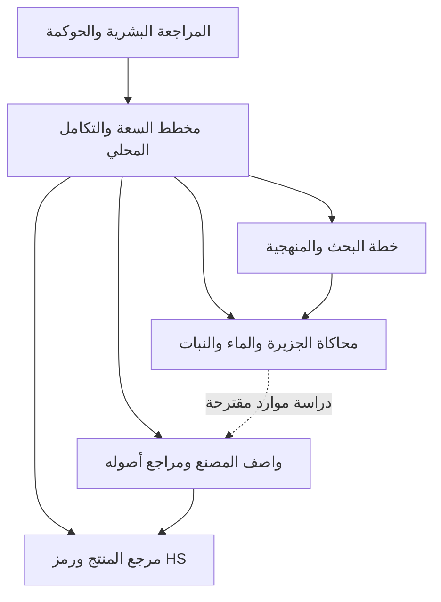

# مخطط تكامل وكلاء شيخة

تاريخ المتابعة: 2026-10-23 بتوقيت الرياض. النطاق: تصميم محلي وأمثلة محاكاة محدودة، لا نشر ولا تشغيل أجهزة ولا تكاثر غير محدود. المرجعية القيمية للمشروع هي الكتاب والسنة مع مراجعة بشرية؛ ليست شهادة امتثال آلية أو نموذجًا للغيب أو لجسد النبي صلى الله عليه وسلم.

## ما أضيف

الوحدة `runtime/sheikha-infinite-agent/v1/sheikha-agent-integration-plan.js` تعيد استخدام النواة الوصفية الحالية ونموذج الطبيعة وخطة البحث والمحاكاة الصناعية؛ لا تنشئ نواة بديلة أو واجهة HTTP إضافية.



- `planHierarchy(branching)` يحسب عدد الأوصاف في كل مستوى بأعداد صحيحة دقيقة دون إنشاء الشجرة أو عمليات عمل. الأعداد في الناتج سلاسل عشرية لتجنب فقد الدقة. كل عنصر في `branching` هو عدد الأبناء لكل أب في المستوى السابق.
- الحدود مأخوذة من النواة الحالية: 1000 وصف إجمالًا، عمق 8، و100 ابن لكل أب، وحصة 1000 وحدة تسجيل. هذه ليست ميزانية مالية أو حصة حوسبة، والنجاح لا يحجز موارد ولا يمنح إذن تشغيل.
- المثال الافتراضي `[10,5,2]` يصف 161 عقدة. طلب `[100,10,1000]` يصف 1,001,101 عقدة ويرجع `CAPACITY_BLOCKED`، دون إنشائها. مدخل التخطيط نفسه محدود بـ64 مستوى ومليون ابن لكل مستوى للحساب فقط، ولا يرفع حدود القبول.
- `buildIntegrationPlan(input)` يعيد خمسة واصفات تمثيلية فقط: منسق، منتج، مصنع، بحث، وحديقة. هذا سجل أمثلة منفصل عن الهيكل المطلوب، وليس خمسة عمال نشطين ولا تشغيلًا للهيكل كله.
- رمز HS اختياري من 4 أو 6 أرقام، مع الحفاظ على الأصفار الأولى. الفحص شكلي فقط؛ لا يتحقق من التصنيف أو الإصدار أو الدولة، ولا يصلح لإقرار جمركي.
- مراجع المصنع والموقع والسجل والفوندري والمصدر وخط الإنتاج أوصاف غير متحققة، وليست إثبات ملكية أو اتصال. لا تدخل مفاتيح أو بيانات أشخاص في هذه الحقول.
- مراحل الإمداد الثماني وأنماط اللوجستيات الستة قالب مأخوذ من الطلب، وليس مسارًا صالحًا لكل منتج. سجل الحركات والمحاسبة الكمية والربط بالنقل غير منفذة في هذه الوحدة.
- خطة البحث تستعمل كتالوج المنهجيات الموجود. المثال النباتي يعيد بيانات اصطناعية موسومة ولا يدرب نموذجًا. المثال الصناعي يشغّل المحاكاة الرقمية القائمة ذات الخلايا السبع؛ اكتمالها لا يثبت إنتاجًا حقيقيًا أو صلاحية معدات.

## الاستخدام المحلي

```bash
node tools/runtime/sheikha-agent-integration-plan.cjs --scenario island --hs-code 7208
node tools/runtime/sheikha-agent-integration-plan.cjs --branching 100,10,1000
node tests/sheikha-agent-integration-plan.test.cjs
```

الأداة تطبع JSON دون حفظ ملفات أو تشغيل خدمات. رمز الخروج `0` لخطة ضمن حدود الأوصاف، و`1` لتجاوز السعة، و`2` لمدخل غير صالح. لا يعاد نص المدخل المرفوض في رسالة الخطأ. السيناريوهات: `island` و`meadow` و`arabia`، وجميعها اصطناعية.

للتكامل البرمجي تدعم الوحدة أيضًا `factoryRef` و`registrationRef` و`locationRef` و`foundryRef` و`sourceRef` و`pipelineRef` و`scienceRef` و`method` من كتالوج البحث الموجود. المراجع معرفات قصيرة وليست URLs أو أوامر. رفض أنماط اعتماد معروفة لا يشكل نظامًا شاملًا لاكتشاف الأسرار.

أضيفت أداة CLI إلى مداخل سياسة سياق البناء لتتبع استيراداتها وملف كتالوج المنهجيات. هذا تحضير محلي، لا رفع تلقائي.

## مراجعة المرفق

السجل المرفق يتضمن أخطاء قديمة من 22 أكتوبر ومسارات `[STRIPPED ...]` وأسطرًا مخفية. لم تُشغّل هذه الأوامر أو يُستبدل بها `server.js`. ربط النواة الحالي موجود قبل معالج 404، والمسارات المحمية تتطلب JWT إداريًا. `GET /spawn` لا ينشئ وكلاء؛ الإنشاء المحلي عبر POST مصادق عليه ومحدود.

نجاح `/status` يثبت إتاحة ذلك المسار فقط، وليس إقلاع bare metal أو تدريب AI أو إنشاء مصنع. أسماء مثل «اللانهائي» و«الكوني» لا تثبت تلك القدرات. محاكاة الذرات غير منفذة وتعيد 501 للمستخدم الإداري، بدل إعلان نجاح شكلي. المسار المرجعي للسنة والسيرة لا يتضمن بيانات جسم أو خلايا أو توأمًا بيولوجيًا.

ظهر في المرفق نص لقيم JWT والتشفير. لم تُنسخ أو تُستخدم هنا. إن كانت قيمًا مستخدمة فعليًا فيجب التعامل معها كمكشوفة، وتدويرها عبر مخزن الأسرار وإبطال الجلسات المتأثرة؛ تدوير مفتاح تشفير بيانات مخزنة يحتاج خطة ترحيل واسترجاع، لا استبدالًا أعمى.

وجهة النشر المحددة سابقًا تبقى الدمام `me-central2` مع Hostinger. لم تُنفذ أوامر المرفق التي تستهدف `us-central1`، أو تغييرات IAM أو DNS أو إعادة تشغيل إنتاجية. سجل عوائق الوصول والبناء السابق في [مراجعة البناء](../environment/SHEIKHA-CLEAN-BUILD-RECOVERY.md) تاريخي، ولم يُعد فحص حساب المزود في هذه المتابعة.

## التحقق والحدود

نجح 60 اختبارًا محددًا دون إخفاق أو تخطٍّ: 14 للتكامل والتخطيط، و8 للنواة، و8 للنموذج الطبيعي، و12 لمسارات HTTP والمصادقة، و18 لسياق البناء. أُعيدت اختبارات HTTP وCLI بالصلاحية اللازمة بعد رفض فتح المنفذ وإنشاء العمليات داخل العزل؛ نجاحها ليس افتراضًا لتجاوز ذلك الرفض.

أصلحت المتابعة قواعد `.dockerignore` و`.gcloudignore` التي احتوت نصًا مبتورًا، مع الحفاظ على استثناءات Git والأرشيفات وبيئة Python و`.mnt`. أضيف فحص `MALFORMED_IGNORE_RULES` لمنع staging عند ظهور علامات اللصق المبتور، واختبار للمداخل المتعددة وكتالوج JSON المتعدي. قواعد التجاهل لا تغني عن أداة الجرد المحدودة وفحص الأسرار.

السياق المعزول `/tmp/SHEIKHA_CLOUD_CONTEXT_V1_6sotwxr2` يحتوي 2883 ملف مصدر، بحمولة 75,639,780 بايت، نحو 73 MiB مع المانيفست. حُلّ 1027 استيرادًا حرفيًا محليًا دون نتائج حجب. نجح تشغيل CLI من هذا السياق، مع خمسة واصفات تمثيلية وخطة 161 وصفًا، دون أوامر أجهزة أو تدريب. الرابط المحلي القديم `node` مستبعد ومحفوظ دون حذف. `/tmp` مؤقت ويلزم إنشاء لقطة جديدة عند تغيير المصدر.

الاختبارات HTTP تخص الموجّه داخل تطبيق Express معزول، وليست إعادة إقلاع للبوابة كاملة أو اختبار Cloud Run. لم تُبنَ حاوية جديدة ولم تُشغّل مجموعة اختبارات المستودع كاملة في هذه المتابعة. لم تُعدّل مسارات HTTP أو `server.js` ضمن هذه الإضافة، وحُفظت التعديلات الموجودة من العمل المتوازي.

النتائج والبصمات المحددة محفوظة في `runtime/sheikha-infinite-agent/v1/integration-verification-20261023.json`. بصمة جرد السياق: `779d3c663737d3f2ce9886741622107ff025ce5aff93b79f12a18527f4d87a8f`. يسبق السياق ملف التحقق هذا؛ لا يدعي التقرير أنه موجود بداخله.

لا تشمل النتائج اعتمادًا جمركيًا أو حكوميًا أو شرعيًا، ولا تشغيل نماذج أو أجهزة، ولا نجاح نشر سحابي. يبقى `PRODUCTION_HOLD` ولا تستبدله أعلام يرسلها المستدعي.
