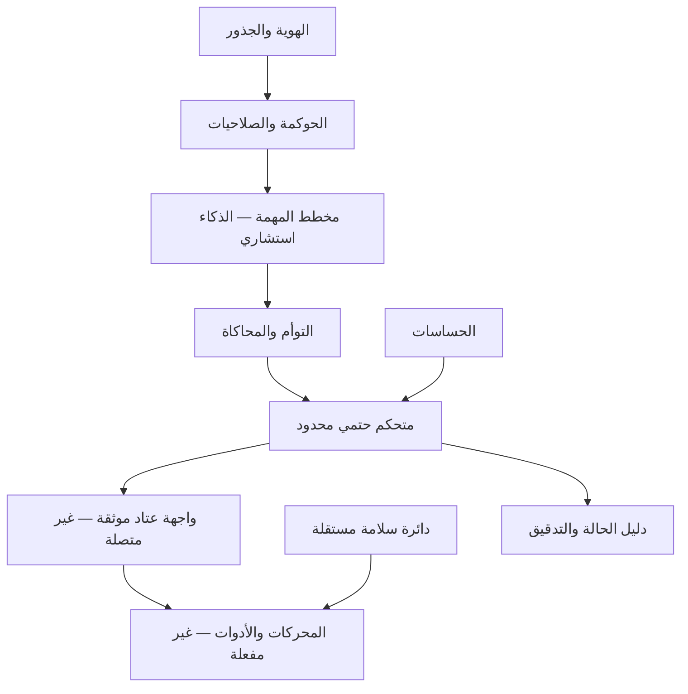
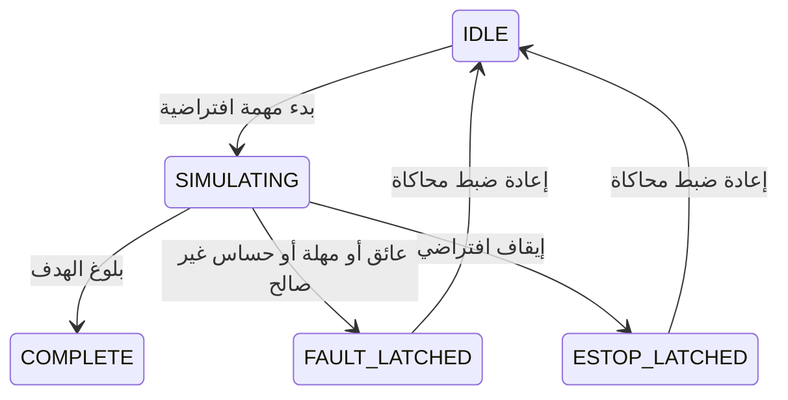
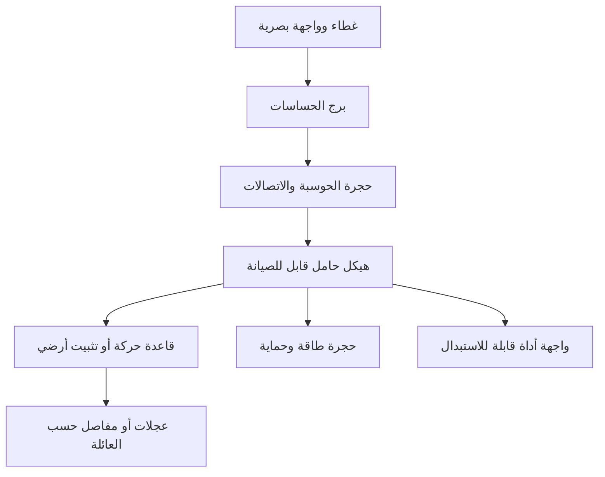
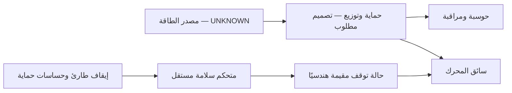
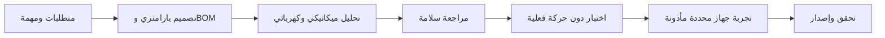

# روبوتات شيخة — التصميم والهوية والمعمارية

## المرجعية البصرية والهوية

راجعت الصور الثلاث محليًا. استُخدمت لتوجيه لوحة الأخضر والذهبي والهيكل الصناعي وتقسيم وظائف المنظومة؛ لم تُنسخ الصور أو بيانات الملكية الموجودة فيها إلى الواجهة. بصمات المراجع محفوظة في blueprint.json. الاسم والأسلوب والقيم مصدرها core/identity/sheikha-identity-v1.json؛ الواجهة تقرأ نسخة JavaScript مطابقة له.

حيوية الهوية هنا حضور رقمي تفاعلي قابل للتجربة، بحالة ومهمة وحركة محاكاة. لا تُسند للبرمجيات حياة بيولوجية أو روحًا أو سلطة دينية. مرجعية الكتاب والسنة قيمية غير تنفيذية، والمراجعة المؤهلة لازمة عند المسائل الشرعية.

## عائلة الروبوتات

| العائلة | المهمة | مرحلة التصميم |
|---|---|---|
| الرقمي | التخطيط والمحاكاة وإظهار الحالة | محاكاة محلية قابلة للتشغيل |
| المتحرك | فحص المستودعات ونقل المواد | تصور قاعدة بعجلات، المهمة النهائية تنتظر التأكيد |
| الذراع | فرز وفحص ضمن خلية ثابتة | تصور، الأدوات والمفاصل UNKNOWN |
| الاستقبال الشبيه بالمرجع | التفاعل والمساعدة | تصميم فقط؛ الاتزان وسلوك التوقف UNKNOWN |

كل عائلة تتشارك الهوية والعقود والسجل والحوكمة، وتملك تعريف عتاد وحدودًا وإصدار Firmware خاصًا بها. لا يعني توحيد الهوية توحيد الحمولة أو الحساسات.

## الجذور والأساسات والنواة

الجذور: مصدر الأصول، غرض مأذون، حقوق وخصوصية، دليل ومراجعة. الأساسات: تعريف المهمة والبيئة، واجهات مقيّدة، صلاحيات مفصولة، وحدات قابلة للاختبار. النواة: آلة حالات للمهمة، بيانات حساسات مؤرخة، مراقبة مهلة، توقف مثبت، وسجل محدود لا يحفظ بيانات شخصية.

## المخطط الميكانيكي المفاهيمي

الأبعاد، الكتلة، الحمولة، مركز الثقل، سرعة الحركة، مسافة التوقف، المواد، المحركات، البطارية، الحماية البيئية، تحليل الإجهاد والتصادم والحرارة: UNKNOWN. الرسم المعروض مفهوم بصري وليس مخطط تصنيع معتمدًا. قيم المحاكاة عددية تعليمية، ولا تتحول إلى حدود آمنة للأجهزة.

## الطاقة والسلامة والتكامل

يجب تقييم المخاطر والحماية على مستوى النظام والأداة والبيئة، بما يشمل الاختبار والصيانة؛ هذا موضح في [الدليل الفني للروبوتات لدى OSHA](https://www.osha.gov/otm/section-4-safety-hazards/chapter-4). هذا مرجع هندسي عام ولا يمثل شهادة مطابقة أو حكمًا على المتطلبات المحلية. اختيار حالة توقف الروبوت يعتمد على تصميمه؛ قطع الطاقة العشوائي ليس خطة اتزان لروبوت يمشي.

عقد التكامل الفعلي يتطلب معرف جهاز وجلسة وتسلسلًا ووقت انتهاء ونطاق أمر وحدودًا معايرة وهوية متحققة وحالة سلامة مستقلة. البروتوكول وطراز العتاد والتوقيع الفعلي UNKNOWN. واجهة إرسال أوامر الأجهزة محجوبة، والرايات التي يرسلها العميل لا تفتحها.

## التنظيم والإنتاج

الأدوار: معماري النظام، الميكانيكا، الكهرباء، البرمجيات المضمنة، التحكم، البرمجيات، مراجع السلامة، الجودة، واعتماد الإصدار. الأشخاص UNKNOWN؛ مرجع المالك سري ولا يكرر في المستندات المعروضة.

التفعيل الحالي: ملف .shk يترجم ويشغّل محاكاة الروبوت عبر أمر حاكي_روبوت. الروبوت الرقمي مستضاف في المتصفح أو Node.js؛ تشغيله في بيئة شيخة الأصلية لم يثبت. SDK وواجهة /api/sheikha/robotics/v1 جاهزان محليًا، ولم يبدأ خادم جديد.

حالة العمل: LOCAL_DESIGN_AND_SIMULATION_VERIFIED. المخطط الكامل للتصنيع ينتظر المهمة والعتاد والقياسات المطلوبة.
