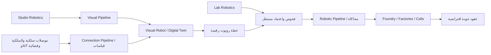

# Sheikha Robotics — الوحدات والموصلات والمسارات

توحيد أسماء المستخدم الإملائية تحت Sheikha؛ لا يعني إنشاء علامات تجارية مسجلة أو اعتماد ملكية قانونية.

| الوحدة | مسؤوليتها | الناتج المحلي |
|---|---|---|
| Sheikha Visual Robot | هوية الروبوت وتوأمه البصري | لوحة هوية ومجسم تجريبي |
| Sheikha Visual | الرسوم والمشاهد والحركة | SVG وOBJ ومشهد زمني وفيديو تخطيطي |
| Sheikha Robotics | الحالة والحركة والصيانة | محاكاة روبوت وشبكة خلايا |
| Sheikha Lab Robotics | اختبارات الأعطال والتعافي والموصلات | اختبارات برمجية؛ مختبر عتاد UNKNOWN |
| Sheikha Studio Robotics | تصميم المجسم والإشارات | عارض محلي؛ CAD تصنيع UNKNOWN |
| Sheikha Foundry Robotics | الفوندري والمصانع والتجميع | سبع خلايا محاكاة؛ المصانع الفعلية UNKNOWN |
| Sheikha Robotic Pipeline | تدفق عقود الإنتاج | موارد → تصنيع → تجميع → جودة → توزيع |
| Sheikha Visual Pipeline | تدفق الوسائط | مصدر .shk → مشهد → رسم ومجسم وحركة |
| Sheikha Connection Pipeline | تدفق القياسات | ظرف → فحص عقد → تسلسل وصلاحية → قياسات افتراضية |
| Sheikha Robotic Connectors | عقود الوصلات | خمس فئات، دون نقل فعلي |

| الموصل | الاستخدام المخطط | الإثبات |
|---|---|---|
| Wire | ربط روبوت أو خلية بكابل وفق عتاد محدد لاحقًا | تحقق ظرف قياس محلي فقط |
| Wireless | قياسات متنقلة بعد تحديد العتاد والبروتوكول | محاكاة فقط |
| IoT | جمع قياسات أجهزة عبر بوابة محددة لاحقًا | محاكاة فقط |
| Satellite | وصلة بعيدة عبر مزود وطرفية محددين لاحقًا | محاكاة فقط؛ التغطية والزمن والتكلفة UNKNOWN |
| Hybrid | اختيار أو تحويل روابط وفق سياسة لاحقة | تحقق ظرف فقط؛ failover الفعلي UNKNOWN |

هذه فئات تصميم وليست drivers أو بروتوكولات مثبتة. البروتوكول ومصنع الموصل والطرفية والأبعاد والجهد والتردد والتراخيص وجودة الخدمة UNKNOWN. لا يوجد شراء أو تهيئة أو اتصال شبكة. المصهر الحراري ليس مصنع أشباه موصلات؛ وصفاتهما وتجهيزاتهما الدقيقة UNKNOWN.

عقد المحاكاة يقبل فقط version وdeviceId ثابتًا افتراضيًا وsequence وissuedTick وexpiresTick وkind=telemetry وpayload={health,position}. يرفض الحقول الإضافية وأوامر التشغيل وتسلسلًا مكررًا أو فترة صلاحية غير سليمة أو قياسات غير صالحة. الزمن وحدات محاكاة وليس وقتًا إنتاجيًا. لا يثبت اسم الجهاز مصادقة ولا توقيعًا؛ authenticatedDevice=false وcryptographicVerification=UNKNOWN.

مقتضيات الاتصال الحقيقي: سجل أجهزة وصلاحيات، بروتوكول ونقل موثقان، إثبات تشفيري مستقل، حماية إعادة الإرسال عبر جلسات، معايرة القياسات، مراقبة فقد الاتصال ومراجعة توقف الحركة لكل عتاد، واختبار المختبر واعتماد تشغيل مستقل. قبول قياس لا يسمح بحركة. أدوات المحاكاة لا تحتوي على اتصال عتاد أو أسرار.

المصدر sheikha-language/robots/sheikha-robotic-connectors-v1.shk. تشغيل التحقق المحلي: node tools/production/sheikha-robotic-connectors-v1.cjs. الدليل runtime/sheikha-robotics/connectors-v1/verification.json. المضيف Node.js؛ الضيف الأصلي UNKNOWN. القيم الشرعية والخصوصية وبلا ضرر ولا ضرار تستلزم مراجعة مؤهلة، ولا تدّعي الوثيقة اعتمادًا شرعيًا أو هندسيًا.
