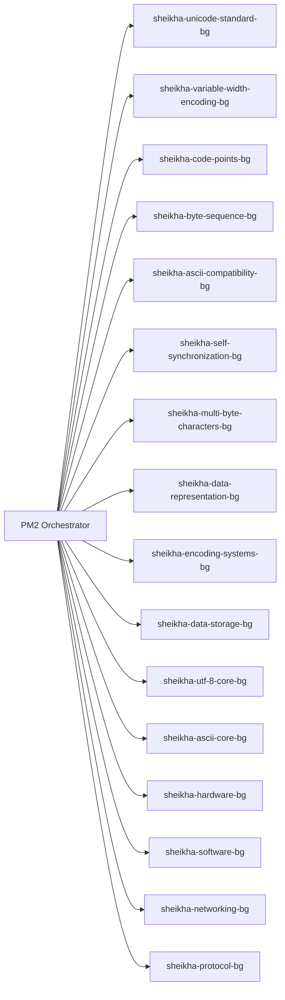

# منظومة شيخة الهندسية المتكاملة

## الرؤية
منظومة رقمية متكاملة أساسها عربي، تعمل بطبقات مترابطة: العتاد، البرمجيات، البيانات، الشبكات، والحوكمة التشغيلية.

## المبادئ
- الأساس اللغوي: العربية أولاً.
- الترجمة: جاهزية تشغيلية لجميع اللغات.
- الاعتمادية: كل مكوّن يعمل كخادم خلفي مستقل ويمكن مراقبته.
- الحوكمة: قيم العدالة والأمانة وعدم الضرر في التشغيل والبيانات.

## طبقات المنظومة

### 1) طبقة العتاد (Sheikha Hardware)
- Sheikha CPU
- Sheikha ALU
- Sheikha Control Unit (CU)
- Sheikha RAM / ROM
- Sheikha HDD / SSD
- Sheikha Motherboard
- Sheikha Bus
- Sheikha I/O Devices

### 2) طبقة البرمجيات والبيانات (Sheikha Software & Data)
- Sheikha OS / Sheikha Kernel
- Sheikha Data Representation
- Sheikha UTF-8 / Sheikha ASCII
- Sheikha Programming Languages (High + Low level)
- Sheikha Compiler / Interpreter
- Sheikha File Systems / Algorithms / Data Structures

### 3) طبقة الشبكات (Sheikha Networking)
- Sheikha IP Address
- Sheikha Protocol + Sheikha HTTP + Sheikha TCP/IP
- Sheikha NIC

### 4) طبقة التوحيد الذكي (Sheikha Unified Core)
- تجميع الطبقات السابقة في نواة تنفيذية واحدة.
- توجيه عربي-أساس ثم ترجمة عالمية.
- تشغيل بخدمات خلفية مستقلة عبر PM2.

## مخطط البنية العامة

```mermaid
flowchart TB
    A[Sheikha Unified Core]\nArabic-First\nGlobal Translation --> B[Sheikha Hardware]
    A --> C[Sheikha Software and Data]
    A --> D[Sheikha Networking]
    A --> E[Sheikha Governance Layer]

    B --> B1[CPU ALU CU]
    B --> B2[RAM ROM]
    B --> B3[HDD SSD]
    B --> B4[Motherboard Bus I/O]

    C --> C1[Sheikha UTF-8]
    C --> C2[Sheikha ASCII]
    C --> C3[Data Representation]
    C --> C4[Encoding Systems]
    C --> C5[Data Storage]

    D --> D1[Sheikha IP]
    D --> D2[Sheikha Protocol]
    D --> D3[Sheikha HTTP TCP/IP]
```

## مخطط التنفيذ الخلفي



## أوامر التشغيل
- تشغيل المنظومة الموحدة: `npm run -s ops:sheikha:unified:start`
- إيقاف المنظومة الموحدة: `npm run -s ops:sheikha:unified:stop`
- حالة المنظومة الموحدة: `npm run -s ops:sheikha:unified:status`
- تشغيل stack الترميز الكامل: `npm run -s ops:unicode:bg:start`

## مخرجات التكامل
- كل نظام مفعّل كخادم خلفي مستقل.
- مخطط هندسي واضح لكل طبقة.
- نواة موحدة تجمع الأنظمة بذكاء تشغيلي.
- أساس عربي كامل مع قابلية ترجمة عالمية.
