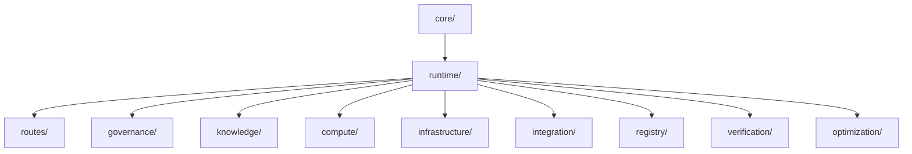

# شيخة — خريطة البنية التشغيلية (Topology Map)

- هذا الملف يوضح العلاقات بين جميع مكونات التشغيل (Canonical Runtime Tree)
- كل عقدة تمثل وحدة تشغيلية أو معرفية أو حوكمة

- كل تحديث في الشجرة يجب أن ينعكس هنا وفي GLOBAL_MANIFEST.md
