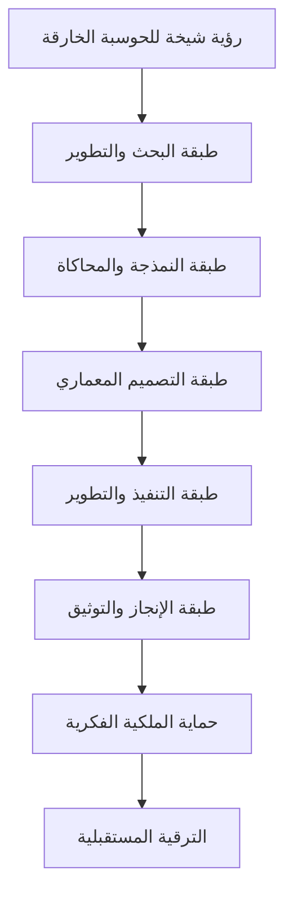

# المخطط المعماري الأولي — شيخة سوبركمبيوتنج


```

- كل طبقة موثقة وتخضع للحوكمة والسرية.
- قابلية التوسع والتطوير مدمجة في كل مرحلة.

---
*تم إنشاء هذا الملف تلقائياً بواسطة Sheikha Codex. جميع الحقوق محفوظة.*