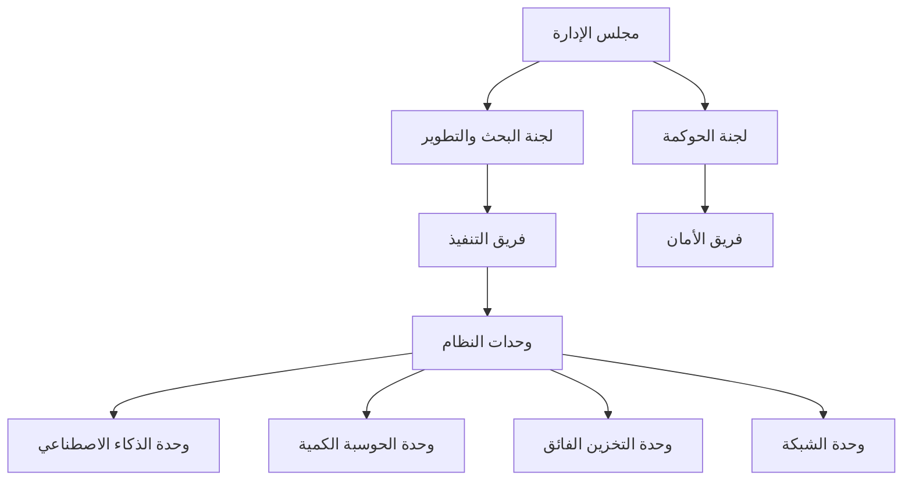

# الهياكل التنظيمية والمعمارية — شيخة سوبركمبيوتنج

## الهيكل التنظيمي
- مجلس إدارة المشروع (مالك/مخترع)
- لجنة البحث والتطوير
- لجنة الحوكمة والمراجعة
- فريق التنفيذ والتشغيل
- فريق الأمان والحماية

## الهيكل المعماري

```

## القواعد الأساسية
- كل وحدة تخضع للحوكمة والمراجعة.
- قابلية التوسع والتطوير في كل طبقة.
- توثيق كل قرار وكل تطوير.

---
*تم إنشاء هذا الملف تلقائياً بواسطة Sheikha Codex. جميع الحقوق محفوظة.*
